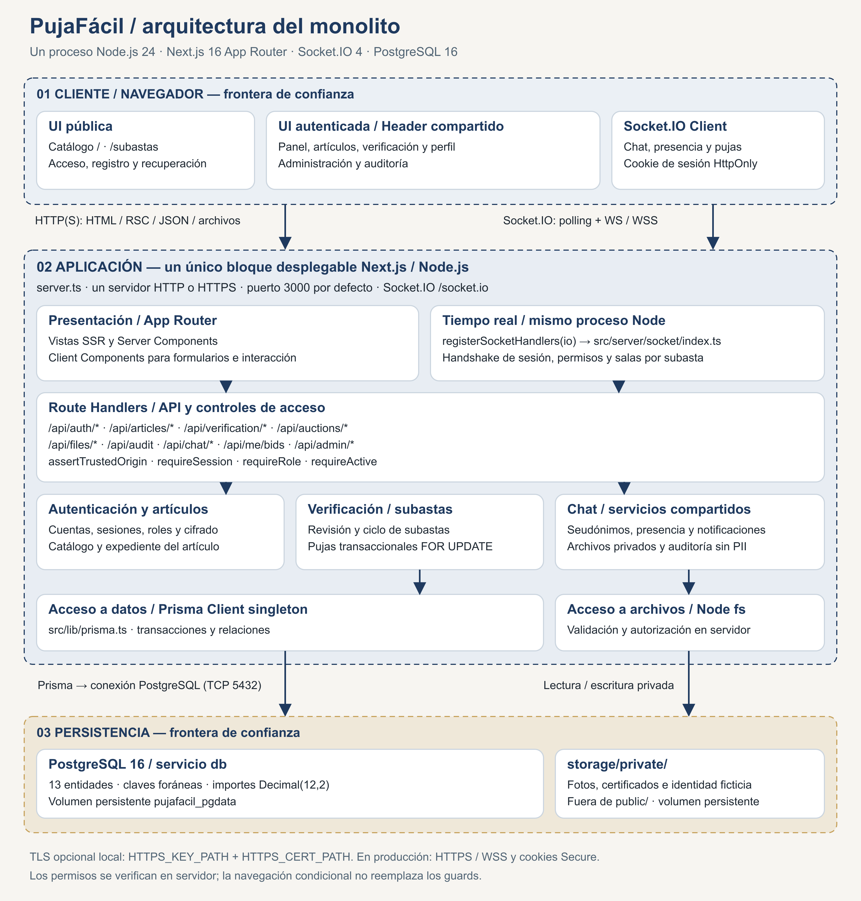
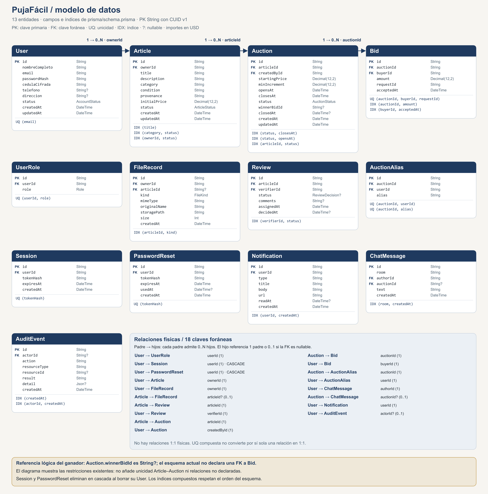

# PujaFácil — Casa de Subastas en Línea

PujaFácil es una plataforma web de subastas privadas para Casa de Subastas Áurea, PYME ecuatoriana. Permite comercializar artículos exclusivos y de alto valor mediante publicaciones administradas, verificación de autenticidad y ofertas concurrentes. Resuelve la dispersión de expedientes, ofertas y conversaciones de una operación manual, manteniendo la confidencialidad de los participantes. Proyecto desarrollado para el primer bimestre de **Aplicaciones Web Avanzadas** y **Desarrollo de Software Seguro**.

---

## 1. Alcance del Proyecto (1B)

El alcance previsto del primer bimestre cubre el ciclo comercial central de una casa de subastas mediante un **monolito único en Next.js**:
- **Registro y Acceso Seguro:** Registro con documento de identidad ficticio, validación en servidor, almacenamiento de contraseñas con hash + sal (`bcryptjs`), sesión mediante cookie `HttpOnly` y recuperación de cuenta con token de un solo uso de caducidad temporal.
- **Catálogo y CRUD de Artículos:** Publicación de artículos por vendedores activos, subida y validación estricta de fotografías/certificados privados, filtros por categoría y búsqueda paginada.
- **Verificación Técnica:** Asignación de artículos a verificadores y evaluación de autenticidad antes de su publicación en subasta.
- **Subastas y Pujas en Tiempo Real:** Gestión de subastas programadas/activas, registro concurrente de ofertas mediante transacción en PostgreSQL y difusión en vivo vía WebSockets (`Socket.IO`).
- **Chat y Presencia:** Sala general y salas de subasta en tiempo real con historial persistido y seudónimos protegidos (`AuctionAlias`).
- **Auditoría:** Registro de eventos del sistema sin filtración de datos de carácter personal (PII).

> **Aviso de Privacidad y Seguridad:** Todos los datos de usuarios, documentos de identidad, cédulas y fotografías utilizados en este repositorio y en las demostraciones son **estrictamente ficticios**.

---

## 2. Stack Tecnológico

- **Entorno de Ejecución:** Node.js 24 LTS
- **Framework Web:** Next.js 16 (App Router, Server Components y Route Handlers; compilación con webpack)
- **Lenguaje:** TypeScript 5
- **Estilos:** Tailwind CSS 4 con tokens de diseño propios (`.pf-*`)
- **Base de Datos:** PostgreSQL 16
- **ORM:** Prisma ORM 6
- **Tiempo Real:** Socket.IO 4 (integrado en el mismo proceso y puerto HTTP/HTTPS de Node)
- **Validación:** Zod
- **Criptografía y Sesiones:** `bcryptjs`, cifrado simétrico AES-256-GCM y cookies `HttpOnly`
- **Pruebas Automatizadas:** Vitest
- **Contenedores:** Docker y Docker Compose

---


## 3. Responsables

| Integrante | Módulo |
|---|---|
| Jonathan | Prisma, archivos privados, auditoría, Docker e integración |
| Christian | Autenticación, sesiones, roles y cifrado |
| Leonel | UI compartida, artículos y catálogo |
| Antony | Verificación y ciclo de subastas |
| Kevin | Socket.IO, pujas, chat y notificaciones |

La entrega de integración del **16 de noviembre de 2026**, en la rama `jonathan`, reúne los cinco módulos: identidad y revisión de cuentas, artículos y catálogo, verificación y subastas, pujas/chat/notificaciones y servicios de archivos/auditoría. El Header compartido está incorporado al layout y consulta la sesión al cambiar de ruta para actualizar la navegación tras el acceso. Las comprobaciones automatizadas y las comprobaciones con base de datos real se distinguen en la sección 7.

### Arquitectura integrada

`server.ts` carga el entorno con `@next/env` antes de importar los módulos de sesión, crea **un único servidor HTTP o HTTPS**, registra una instancia de Socket.IO con `registerSocketHandlers(io)` de `src/server/socket/index.ts` y atiende App Router y `/socket.io` en el mismo puerto (3000 por defecto). Pasa `PORT` a Next.js para que la validación del origen coincida también en puertos alternativos. `npm run dev` y `npm run start` ejecutan este servidor; `next dev` y `next start` por sí solos no registran los handlers de chat.

Las vistas SSR/Server Components, Route Handlers y módulos de negocio viven dentro del mismo proceso Node. Los guards validan sesión, estado, rol y origen en servidor; Prisma accede a PostgreSQL y los binarios se guardan fuera de `public/` en `storage/private/`. El navegador, la aplicación y la persistencia son las tres fronteras de confianza del diagrama.



Las trece entidades y todas sus FK, restricciones únicas e índices se muestran en el modelo; el [detalle textual](docs/modelo-datos.md) facilita su consulta.



Las PK son `String @default(cuid())` (CUID v1) y las FK son cadenas del mismo tipo; las restricciones únicas protegen correo, tokens, roles, alias e idempotencia de pujas.<br>
Los índices `(category, status)`, `(status, closesAt)`, `(auctionId, amount)` y `(room, createdAt)` apoyan catálogo, cierre de subastas, pujas e historial; el orden coincide con Prisma.

## 4. Requisitos Previos

Antes de ejecutar el proyecto, asegúrate de contar con:
1. **Node.js 24 LTS:** Verifica con `node -v` (ejemplo: `v24.22.x`).
2. **Docker Desktop:** Instalado y en ejecución (el servicio de Docker debe estar activo para levantar la base de datos).
3. **PowerShell en Windows:** Usa `npm.cmd` y `npx.cmd` si la política local impide ejecutar los scripts `.ps1`; no hace falta modificar esa política.

---

## 5. Guía de Instalación y Ejecución Paso a Paso

Sigue estos pasos para poner en marcha el proyecto localmente:

### Paso 1: Clonar el repositorio
```bash
git clone https://github.com/SnowPoom/PujaFacil.git
cd PujaFacil
```

### Paso 2: Instalar las dependencias
```powershell
npm.cmd ci
```

### Paso 3: Configurar variables de entorno
Copia la plantilla de variables de entorno y ajusta los valores locales necesarios:
```powershell
Copy-Item .env.example .env
```
Completa `DEMO_PASSWORD` con una contraseña ficticia de demostración y sustituye `ENCRYPTION_KEY_HEX` por una clave generada localmente. La plantilla contiene marcadores, no claves utilizables:

```powershell
node -e "console.log(require('node:crypto').randomBytes(32).toString('hex'))"
```

Conserva esa clave entre ejecuciones para poder descifrar los registros. **Nunca agregues `.env` a Git.**

### Paso 4: Levantar la base de datos PostgreSQL
Inicia el contenedor de base de datos con Docker Compose:
```bash
docker compose up -d db
```
Para verificar que el contenedor esté listo y saludable:
```bash
docker ps --filter "name=pujafacil_db"
```
*(Debe mostrar el estado `Up ... (healthy)`).*

### Paso 5: Aplicar migraciones y generar el cliente Prisma
Aplica las migraciones pendientes en la base de datos:
```powershell
npx.cmd prisma migrate deploy
npx.cmd prisma generate
```

### Paso 6: Cargar datos iniciales de prueba (Seed)
Inserta los usuarios de prueba, artículos y subasta demostrativa:
```powershell
npm.cmd run db:seed
```

### Paso 7: Iniciar el servidor de desarrollo
Inicia el servidor Node con soporte de recarga en caliente y WebSockets:
```powershell
npm.cmd run dev
```
Verás en consola:
```text
[server] Modo HTTP (desarrollo local sin TLS)
[server] Escuchando en http://localhost:3000
```

### Paso 8: Abrir en el navegador
Ingresa a:
👉 **[http://127.0.0.1:3000](http://127.0.0.1:3000)**

Se usa webpack con el loader de Tailwind instalado dentro de la cadena CSS de Next para evitar el fallo de workers de Turbopack observado en Windows. No se actualizaron versiones ni se instalaron dependencias adicionales.

---

## 6. Cuentas y catálogo de demostración

Todos los datos de esta sección son sintéticos. La contraseña común de las cuentas creadas por el seed está en `DEMO_PASSWORD` del archivo local `.env`; no se guarda en este README.

| Rol | Correo | Estado inicial |
|---|---|---|
| Administración | `admin@pujafacil.test` | ACTIVA |
| Auditoría | `auditor@pujafacil.test` | ACTIVA |
| Verificación | `verificador@pujafacil.test` | ACTIVA |
| Segunda verificación | `verificador2@pujafacil.test` | ACTIVA |
| Venta | `vendedor@pujafacil.test` | ACTIVA |
| Compra | `comprador1@pujafacil.test` | ACTIVA |
| Segunda compra | `comprador2@pujafacil.test` | ACTIVA |
| Compra y venta | `comerciante@pujafacil.test` | ACTIVA |
| Cuenta por revisar | `pendiente@pujafacil.test` | PENDIENTE |

El seed crea hasta 24 artículos exclusivos con fotografías diferentes, precios en USD y procedencias declaradas en Quito, Guayaquil, Cuenca, Loja y Montecristi. Incluye relojería, joyería, arte, instrumentos, cámaras y antigüedades; hay borradores, correcciones, expedientes asignados y subastas activas, programadas y finalizadas. Las fotografías y sus atribuciones están en `prisma/assets/catalog.json`; se copian al almacenamiento privado mediante el servicio de subida. Las fichas de identidad son sintéticas y tienen una indicación de que carecen de validez oficial.

La carga conserva cuentas y expedientes existentes: no borra registros, no cambia contraseñas de cuentas ya creadas y no reinicia decisiones ni fechas comerciales. Para cuentas nuevas utiliza `DEMO_PASSWORD`. Los artículos y las subastas usan CUID de 25 caracteres con prefijo fijo `cseed2026` para evitar duplicados. Las subastas activas nuevas cierran 48 horas después de la carga; la programada abre una hora después. Repetir el seed no vuelve a abrir una subasta cerrada.

El alcance del primer bimestre termina en cierre y adjudicación. Los pagos en línea y la entrega pertenecen a la evolución posterior del negocio.

---

## 7. Comandos de Verificación y Calidad

Para comprobar la integridad del proyecto antes de realizar un Pull Request:

```powershell
# 1. Comprobar reglas de estilo con ESLint:
npm.cmd run lint

# 2. Ejecutar pruebas automatizadas con Vitest:
npm.cmd test

# 3. Compilación optimizada para producción:
npm.cmd run build
```


Para ejecutar el build local como producción, define el entorno antes de arrancar el servidor:

```powershell
$env:NODE_ENV = "production"
npm.cmd run start
```

En una nueva terminal de desarrollo, usa `npm.cmd run dev` sin esa variable de producción.

---

## 8. Configuración Opcional de HTTPS / WSS Local

El servidor `server.ts` soporta TLS de forma nativa sin requerir un proxy inverso (Nginx o Caddy). Para activar HTTPS y WebSockets seguros (`wss://`):

1. **Generar certificados locales de desarrollo** (ejemplo con OpenSSL en terminal):
   ```powershell
   New-Item -ItemType Directory -Force .certs
   openssl req -x509 -nodes -newkey rsa:2048 -keyout .certs/dev-key.pem -out .certs/dev-cert.pem -days 7 -subj "/CN=localhost" -addext "subjectAltName=DNS:localhost"
   ```
2. **Configurar en `.env`:**
   ```dotenv
   HTTPS_KEY_PATH=.certs/dev-key.pem
   HTTPS_CERT_PATH=.certs/dev-cert.pem
   ```
3. **Reiniciar con `npm.cmd run dev`**, abrir `https://localhost:3000/` y confiar explícitamente en el certificado local en el navegador. Si OpenSSL no está disponible, proporciona un par de certificados de desarrollo existente y ajusta las rutas. Para volver a HTTP deja ambas variables vacías; configurar solamente una detiene el servidor.
4. Inicia sesión con una cuenta ficticia activa y abre `/chat` o una subasta. En DevTools → Red (Network) → WS, comprueba una conexión `wss://localhost:3000/socket.io/...`. Abre una segunda sesión en otro perfil de navegador y comprueba entrega de mensajes y presencia en la misma sala. Si solo aparece polling, aún no se ha demostrado WSS; la guía es un procedimiento, no evidencia de una prueba ejecutada.

`http://localhost` permite WS sin cifrar durante desarrollo. Para acceso público se requieren HTTPS/WSS y certificados válidos. La carpeta `.certs/` está excluida en `.gitignore`: no subas claves privadas, certificados de prueba ni capturas que revelen secretos.

## 9. Archivos privados y auditoría (J2)

`POST /api/files` recibe `multipart/form-data` con `file`, `kind` y `articleId` opcional. Exige sesión activa y cabecera `Origin` de la misma aplicación. El artículo debe pertenecer al usuario; `IDENTIDAD` no se asocia a artículos. El registro inicial de identidad puede consumir `saveValidatedUpload` internamente desde el módulo de autenticación, sin habilitar subidas anónimas.

| Tipo | Formatos reales | Límite | Lectura en `GET /api/files/[id]` |
|---|---|---|---|
| `IDENTIDAD` | JPEG, PNG, WebP o PDF | Imagen 10 MB; PDF 20 MB | Titular con sesión válida o `ADMIN_SUBASTAS` activo para revisar una cuenta `PENDIENTE` |
| `CERTIFICADO` | PDF | 20 MB | Titular, administrador o verificador asignado |
| `FOTO` | JPEG, PNG, WebP | 10 MB | Pública para artículo `APROBADO` o `ASOCIADO_SUBASTA`; en otros estados, titular, administrador o verificador asignado |

Los límites se calculan en bytes (1 MB = 1024² bytes). La validación compara magic numbers, extensión y MIME declarado, rechaza vacíos, nombres con rutas y dobles extensiones, y recodifica las imágenes con Sharp para eliminar EXIF y otros metadatos. Un MIME vacío se acepta si el contenido real y la extensión coinciden. Los PDF se validan por tipo y firma `%PDF-`; no existe análisis antivirus. Los binarios se guardan con UUID en `storage/private`, fuera de `public`, con nombre de respuesta neutro `archivo.ext` para evitar PII en nombres enviados por clientes. No se expone `storagePath`; las lecturas usan `private, no-store`.

**Revisión de cédula/documento de identidad (RN-009 y RF-APP-11):** el titular puede consultar su documento mientras su sesión sea válida, incluso si su cuenta está pendiente. Para consultar el documento de otra persona, se comprueban de nuevo en PostgreSQL el estado `ACTIVA` y el rol exclusivo `ADMIN_SUBASTAS` del solicitante, además del estado `PENDIENTE` del propietario real del archivo. Auditor, verificador y usuarios ajenos no adquieren permiso de lectura. Una vez activado el titular, una nueva solicitud administrativa de revisión se deniega.

Cada consulta administrativa de un archivo de identidad existente registra `IDENTIDAD_CONSULTADA` con referencia interna al administrador, archivo, fecha y resultado (`EXITO`, `DENEGADO` o `ERROR`). La auditoría se realiza dentro de `readAuthorizedFile`, una sola vez por solicitud, antes de entregar los bytes. Si el registro obligatorio falla, GET responde `500 AUDITORIA_NO_DISPONIBLE` sin entregar el documento. No se guardan el contenido, nombres personales, correos, cédulas ni rutas en esos eventos. El acceso del titular a su propio documento no constituye una consulta administrativa.

La revisión documental de una cuenta pendiente no tiene el límite de tres segundos: RN-077 reserva ese límite para el futuro acceso a identidades vinculadas con seudónimos, que continúa fuera del alcance implementado. El cotejo y la activación se integran con el flujo de Christian en `/admin/usuarios`: la lectura administrativa auditada aporta la evidencia para decidir sobre la cuenta.

`deleteFilesForDraft(articleId, ownerId)` exige un borrador propio sin revisiones ni subastas y bloquea el artículo durante la comprobación. Elimina binarios y registros antes de que el módulo de artículos elimine el artículo. Los archivos ya ausentes permiten reintentar. El filesystem y PostgreSQL no comparten una transacción: si un borrado parcial o el commit falla, algunos binarios pueden quedar ausentes aunque el registro persista; el reintento completa la limpieza.

`writeAuditEvent` registra actor interno, acción, recurso, resultado y fecha. Elimina recursivamente campos sensibles; conserva números, booleanos, estados conocidos y los motivos del catálogo cerrado `auditReasonSchema`, y sustituye texto libre por `[REDACTADO]` para impedir PII bajo claves genéricas. Los códigos de acción/recurso/resultado y los identificadores deben ser códigos técnicos, nunca datos personales. Las altas y eliminaciones de archivos registran auditoría en la misma transacción Prisma; un fallo del registro impide devolver éxito.

`GET /api/audit?page=1&pageSize=20&action=ARCHIVO_CREADO` y `/auditoria` son exclusivos de cuentas `AUDITOR` activas. La página ofrece filtro por acción, paginación y tabla con resultados; la API admite de 1 a 100 eventos por página, ordenados por fecha descendente y desempate por ID. No se consultan relaciones de usuarios ni se devuelve la identidad del actor. También se sanitiza `detail` al leer eventos antiguos.

`src/tests/infra.test.ts` cubre firmas reales, límites, EXIF, permisos por tipo/estado/rol, compensación al fallar Prisma o auditoría, borrado protegido, privacidad y contratos HTTP. Incluye revisión de cuentas pendientes, permisos administrativos revalidados, consultas auditadas, bloqueo tras activación y errores de auditoría sin entrega del documento. Las pruebas de infraestructura usan Prisma y disco simulados; no sustituyen las migraciones o pruebas manuales con PostgreSQL.

## 10. Ejecución con Docker

El `Dockerfile` usa Node 24, `npm ci`, generación Prisma y build de Next.js. Arranca `npm run start` con `server.ts`, conservando Socket.IO en el mismo puerto 3000. La imagen usa copias explícitas y `.dockerignore` para excluir `.env`, certificados, archivos privados y `/agent` del contexto de construcción; ejecuta como usuario `node`. Compose espera `db: service_healthy` y monta volúmenes con nombre para PostgreSQL y `/app/storage/private`.

Con `.env` configurado y Docker Desktop activo:

```powershell
docker compose up -d db
docker compose build web
docker compose run --rm web npx prisma migrate deploy
docker compose run --rm -e DEMO_PASSWORD web npm run db:seed
docker compose up -d web
```

Antes del comando de seed, carga `DEMO_PASSWORD` en el entorno de PowerShell con el mismo valor ficticio de `.env`; `-e DEMO_PASSWORD` lo reenvía sin incluirlo en el comando. Compose ya pasa `ENCRYPTION_KEY_HEX` y usa `db` como host de PostgreSQL. Las migraciones y el seed son explícitos y no se ejecutan al arrancar cada contenedor.

Para activar TLS en el contenedor, usa el mismo servicio y volumen privado de Compose, montando los certificados de solo lectura:

```powershell
docker compose stop web
docker compose run --rm --service-ports --name pujafacil_web_tls -v "${PWD}/.certs:/app/.certs:ro" -e HTTPS_KEY_PATH=/app/.certs/dev-key.pem -e HTTPS_CERT_PATH=/app/.certs/dev-cert.pem web
```

Las cookies de producción llevan `Secure`: utiliza HTTPS para iniciar sesión en el contenedor. El arranque por HTTP sirve para comprobar disponibilidad, y el desarrollo local habitual continúa con `npm.cmd run dev`. Compose conserva los archivos en `pujafacil_private` y los datos en `pujafacil_pgdata` (con el prefijo del proyecto Compose). `ENCRYPTION_KEY_HEX` y `SESSION_COOKIE_NAME` se transmiten al contenedor; las rutas TLS de la máquina anfitriona se sustituyen por las rutas montadas. Conserva también la clave de cifrado entre recreaciones.

---

## 11. Documentación y Diagramas

- **Modelo de Datos y Entidades:** Detalle de tablas, tipos y relaciones en [`docs/modelo-datos.md`](docs/modelo-datos.md).
- **Esquema Prisma:** Definición completa en [`prisma/schema.prisma`](prisma/schema.prisma).
- **Arquitectura:** [PNG](docs/arquitectura-monolito.png) · [SVG editable](docs/arquitectura-monolito.svg).
- **Modelo entidad-relación:** [PNG](docs/modelo-datos.png) · [SVG editable](docs/modelo-datos.svg).

---

## 12. Uso de IA

En cumplimiento con las directrices académicas del curso:
- **Herramientas utilizadas:** Codex para implementar los planes J2/15-C y de integración del 16/11, y apoyar la revisión de código.
- **Finalidad:** Servicios de archivos y auditoría, integración del Header y servidor, diagramas SVG/PNG generados con Sharp, configuración Docker, pruebas automatizadas y documentación de ejecución.
- **Revisión:** Se contrasta el código con el esquema Prisma, los permisos, la documentación incluida con Next.js y las comprobaciones lint/test/build. La revisión humana y las pruebas manuales de despliegue, TLS y chat siguen siendo responsabilidad del equipo; no se atribuyen verificaciones que no se hayan ejecutado.

## Verificación local del 18 de noviembre

- ESLint, TypeScript y 364 pruebas automatizadas aprobados durante la revisión de integración.
- Compilación con webpack comprobada tras reemplazar la ejecución de workers de Turbopack por la cadena CSS de Next con el loader Tailwind ya instalado.
- `npx.cmd tsx src/tests/app-flow.integration.ts` verifica contra HTTP y PostgreSQL reales: acceso de cinco cuentas, CRUD con eliminación de un borrador propio, foto, correcciones visibles para el vendedor, reenvío y aprobación, programación, dos clientes con transporte WebSocket, chat, puja en vivo, idempotencia, concurrencia, cierre y ganador. También consulta las pantallas privadas de cada rol. El script crea un artículo comercial de demostración y elimina únicamente su borrador temporal.
- Este recorrido se ejecutó en HTTP local. No constituye una nueva comprobación de TLS/WSS. Las evidencias anteriores de WSS permanecen en `docs/evidencias`.
- Los textos y componentes se ajustaron a la paleta acordada, con fechas de Ecuador continental, estados legibles, navegación por rol y acciones de cuenta pendiente visibles pero deshabilitadas.
- Apoyo de IA: Codex se utilizó para estas correcciones, pruebas y preparación de datos sintéticos. Se conserva el stack del proyecto.
