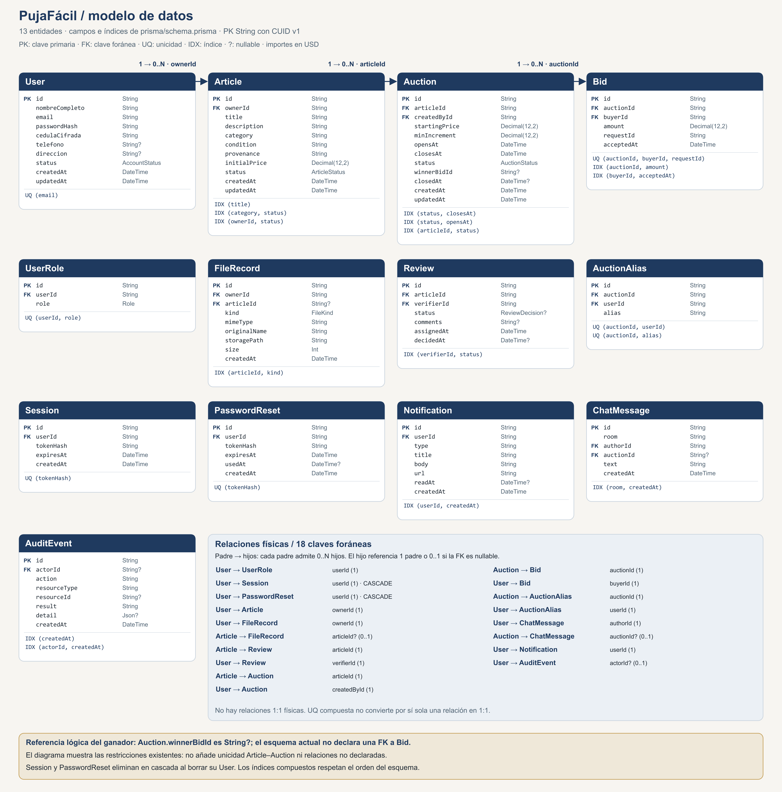

# Modelo de Datos — PujaFácil

> Hito J1 / integración del 16/11/2026 · Jonathan



[SVG editable](modelo-datos.svg).

## Entidades y relaciones principales

| Entidad | PK | Relaciones clave | Propósito |
|---|---|---|---|
| `User` | `id` (cuid) | → `UserRole[]`, `Session[]`, `PasswordReset[]`, `FileRecord[]`, `Article[]`, `Review[]`, `Auction[]`, `Bid[]`, `AuctionAlias[]`, `ChatMessage[]`, `Notification[]`, `AuditEvent[]` | Cuenta de usuario con estado y roles múltiples |
| `UserRole` | `id` | → `User` | Tabla intermedia: un usuario puede ser COMPRADOR y VENDEDOR al mismo tiempo |
| `Session` | `id` | → `User` (Cascade delete) | Token de sesión hasheado con expiración; nunca el token en claro |
| `PasswordReset` | `id` | → `User` (Cascade delete) | Token de un solo uso para recuperación de contraseña (10 min / un uso) |
| `Article` | `id` | → `User` (ownerId), `FileRecord[]`, `Review[]`, `Auction[]` | Artículo en ciclo de 7 estados |
| `FileRecord` | `id` | → `User` (ownerId), `Article?` | Registro de archivo privado; binario en `storage/private/` |
| `Review` | `id` | → `Article`, `User` (verifierId) | Decisión del verificador asignado sobre un artículo |
| `Auction` | `id` | → `Article`, `User` (createdById), `Bid[]`, `AuctionAlias[]`, `ChatMessage[]` | Subasta con apertura/cierre y ganador opcional |
| `Bid` | `id` | → `Auction`, `User` (buyerId) | Puja aceptada; idempotente por `(auctionId, buyerId, requestId)` |
| `AuctionAlias` | `id` | → `Auction`, `User` | Seudónimo único por usuario **por subasta** |
| `ChatMessage` | `id` | → `User` (authorId), `Auction?` | Mensaje de sala `general` o sala `auction:<id>` |
| `Notification` | `id` | → `User` | Notificación interna de inbox (sin correo externo) |
| `AuditEvent` | `id` | → `User?` (actorId) | Log de auditoría sin PII; `detail` es JSON filtrado |

## Diagrama de relaciones

```
User ──< UserRole
User ──< Session          (Cascade delete)
User ──< PasswordReset    (Cascade delete)
User ──< FileRecord       (ownerId)
User ──< Article          (ownerId)       Article ──< FileRecord
User ──< Review           (verifierId)    Article ──< Review
User ──< Auction          (createdById)   Article ──< Auction
User ──< Bid              (buyerId)       Auction ──< Bid
User ──< AuctionAlias                     Auction ──< AuctionAlias
User ──< ChatMessage      (authorId)      Auction ──< ChatMessage
User ──< Notification
User ──< AuditEvent       (actorId)
```

## Enums

| Enum | Valores |
|---|---|
| `Role` | `COMPRADOR` · `VENDEDOR` · `VERIFICADOR` · `ADMIN_SUBASTAS` · `AUDITOR` |
| `AccountStatus` | `PENDIENTE` · `ACTIVA` · `SUSPENDIDA` · `CERRADA` |
| `ArticleStatus` | `BORRADOR` · `PENDIENTE_REVISION` · `REQUIERE_CORRECCIONES` · `APROBADO` · `RECHAZADO` · `ASOCIADO_SUBASTA` · `ARCHIVADO` |
| `AuctionStatus` | `BORRADOR` · `PROGRAMADA` · `ACTIVA` · `SUSPENDIDA` · `CERRADA_SIN_OFERTAS` · `ADJUDICADA` · `CANCELADA` |
| `FileKind` | `IDENTIDAD` · `FOTO` · `CERTIFICADO` |
| `ReviewDecision` | `APROBADO` · `RECHAZADO` · `REQUIERE_CORRECCIONES` |

## Índices

| Tabla | Índice | Propósito |
|---|---|---|
| `Article` | `(title)` | Búsqueda por título |
| `Article` | `(category, status)` | Filtro de catálogo público |
| `Article` | `(ownerId, status)` | Mis artículos por estado |
| `Auction` | `(status, closesAt)` | Consulta de subastas activas/próximas a cerrar |
| `Auction` | `(status, opensAt)` | Consulta de subastas programadas |
| `Auction` | `(articleId, status)` | Subasta de un artículo |
| `ChatMessage` | `(room, createdAt)` | Historial de sala ordenado |
| `Bid` | `(auctionId, amount)` | Oferta más alta por subasta |
| `Bid` | `(buyerId, acceptedAt)` | Mis ofertas cronológicas |
| `AuditEvent` | `(createdAt)` | Panel de auditoría paginado |
| `AuditEvent` | `(actorId, createdAt)` | Eventos por actor |
| `FileRecord` | `(articleId, kind)` | Archivos por artículo y tipo |
| `Review` | `(verifierId, status)` | Bandeja de revisión por verificador y estado |
| `Notification` | `(userId, createdAt)` | Notificaciones cronológicas por usuario |

## Unicidad y cardinalidades

Además de la PK `id` de cada entidad, son únicos `User.email`, `Session.tokenHash` y `PasswordReset.tokenHash`. Las restricciones compuestas son `UserRole(userId, role)`, `Bid(auctionId, buyerId, requestId)`, `AuctionAlias(auctionId, userId)` y `AuctionAlias(auctionId, alias)`.

Cada relación física del esquema es de uno a muchos: un padre puede tener `0..N` hijos, y cada hijo referencia exactamente un padre, salvo `FileRecord.articleId`, `ChatMessage.auctionId` y `AuditEvent.actorId`, que son nullable (`0..1` padre). No existen relaciones físicas uno a uno. `Session` y `PasswordReset` declaran borrado `Cascade` de sus registros al eliminar el usuario.

`Auction.winnerBidId` es una referencia lógica opcional: actualmente no tiene `@relation`, FK ni unicidad declaradas hacia `Bid`. Tampoco hay una restricción única sobre `Auction.articleId`; el esquema admite varias subastas por artículo. El diagrama refleja estas restricciones reales sin añadir otras.

## Convenciones

- **IDs:** `String @id @default(cuid())` — CUID v1; todas las FK son `String`, sin IDs enteros referenciales.
- **Importes:** `Decimal @db.Decimal(12,2)` en USD; serializar siempre como `string` `"120.00"` en JSON
- **Fechas:** `DateTime` UTC, ISO 8601 en JSON; el servidor define apertura/cierre de subastas
- **Tokens:** almacenados como hash SHA-256; el token en claro solo viaja por cookie HTTP-only o enlace de consola
- **Cédula:** `cedulaCifrada` con AES-256-GCM via `encryptCedula()` de Christian (módulo auth)
